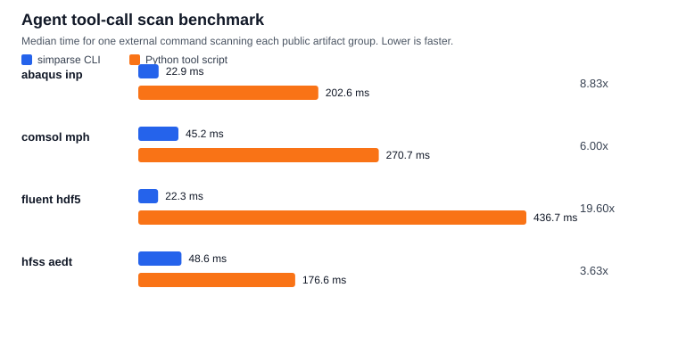

# simparse — offline scanning and export

`sim scan` is powered by [simparse](https://pypi.org/project/simparse/), a
native (Rust) scanner for simulation project and case files. It installs as a
dependency of `sim-cli-core`; no solver, license server or vendor SDK is
needed.

`sim scan` reads metadata, inventories and setup hints from historical
simulation files. Its output inventories large payloads by size and category.

## Saved COMSOL meshes and solutions

```bash
sim export mesh model.mph --sequence mesh1 -o mesh.vtu
sim --json export solution solved.mph --list
sim export solution solved.mph --sequence sol1 --solnum 1 -o solution.json
```

- `export mesh` writes a VTK unstructured grid with saved coordinates,
  element connectivity, and the `comsol_entity` cell array.
- `export solution --list` displays saved solution tags and counts. Select a
  tag with `--sequence` and a 1-based solution number with `--solnum`.
  The JSON file contains `solution` metadata, `solnum`, `real`, and
  `imaginary` or `time_s` when present. Values follow COMSOL's solver DOF
  order. Mapping them to mesh fields requires DOF metadata.

Omit a mesh or solution sequence to let simparse select one. The commands
read the saved payload directly from the MPH file. With `sim --json export`,
the CLI emits a machine-readable receipt or solution inventory on stdout.

## What each format reports

| Format | Files | What you get |
|---|---|---|
| COMSOL | `.mph` | File version, model info and tree (`modelinfo.xml`, `dmodel.xml`, `smodel.json`), licenses used, binary blocks by category and size |
| Abaqus | `.inp`, `.inc` | Include graph, node and element counts, materials, sections, steps, boundary and load keywords, output requests |
| Fluent | `.cas.h5`, `.msh.h5` | HDF5 object tree, attributes, dataset shapes and types, zone, boundary and settings hints |
| Ansys Electronics Desktop (HFSS / Icepak) | `.aedt`, `.aedtz` | Product and version, design and solution types, solved status, variables, setups, sweeps, ports, boundaries, materials, mesh operations, lock/result sidecars; for Icepak designs also solution options, ambient conditions, thermal boundaries and powers, monitors, mesh regions |
| Ansys Mechanical | `.mechdb`, `.mechdat` | Release, object and stream counts, analyses, bodies, materials, contacts, loads and conditions, results, geometry sources, sidecar status |
| Icepak Classic | `.tzr` | Project name, entry and file counts, uncompressed size, `job`/`model` payload presence, entry inventory — streamed without extraction |
| Simcenter FloTHERM | `.xml`, `.floxml` (FloXML) | Model and solve options, grid hints, attribute and geometry inventories, heat-source powers, solution-domain boundaries; generic `.xml` is recognised by its root element |
| Simcenter FloTHERM | `.pack` | Project name, sizes, entry counts, presence of project group and base solution, entry inventory |
| Simulink | `.slx`, `.mdl` | Model kind, release, block and library inventory, subsystems, Stateflow usage, root ports, active solver settings |
| MATLAB data | `.mat` (Level 4, v5–v7, v7.3) | Variables with name, class, dimensions and flags, plus header facts |

## Output properties

- **Bounded.** The default summary returns lists as `{total, sample, truncated}`
  and states parser limits explicitly, so a scan over thousands of files stays
  within an agent's context. `sim scan --full` returns the complete result.
- **Privacy-conscious.** Absolute paths are redacted unless `--include-paths` is
  set.
- **Common IR.** Results carry an additive `ir` field in a shared CAE dialect,
  so downstream tools can read one shape across vendors.
- **Fast to call.** A single process start covers a whole directory, which is
  what an agent tool call pays for.

## Speed

simparse scans roughly **4–20× faster** than a Python tool script doing the
same scan (about 9× typical):

| Files | simparse | Python script | Speed-up |
| --- | --- | --- | --- |
| Abaqus `.inp` | 22.9 ms | 202.6 ms | 8.8× |
| COMSOL `.mph` | 45.2 ms | 270.7 ms | 6.0× |
| Fluent `.cas.h5` / `.msh.h5` | 22.3 ms | 436.7 ms | 19.6× |
| HFSS `.aedt` | 48.6 ms | 176.6 ms | 3.6× |



The benchmark models one agent tool call: a single external command scans a
group of public simulation artifacts. Times are medians of 5 runs and include
process startup and import cost.

## Platforms and license

Prebuilt wheels: Windows x86_64, macOS Apple silicon, Linux x86_64
(manylinux2014). simparse is free to use, including commercially, under the
simparse License (Copyright SVD Lab); the license ships inside the wheel.

Report parser issues or request a format in
[sim-cli issues](https://github.com/svd-ai-lab/sim-cli/issues) with the
`simparse` label.
